# Google Gemini: The Definitive Staff-Level Engineering Masterclass

> **Exhaustive enterprise production guide to Gemini 2.0 Flash, Gemini 1.5 Pro, 2M+ long-context windows, native video/audio understanding, 85% Context Caching, Function Calling, Code Execution sandboxes, and Vertex AI enterprise deployments.**

---

## Stage 1: Architecture, Model Topology & Google GenAI SDK

### 1.1 The Native Multimodal Paradigm: Day-0 Pre-Training

Prior to Gemini, industry "multimodal" models were constructed by retrofitting pre-trained text transformers with separate vision encoders (CLIP) or speech encoders (Whisper). These cascading architectures suffer from semantic information loss at modal projection boundaries.

**Google Gemini was architected from Day 0 as a natively multimodal transformer** (*Gemini Team, Google, 2023*). A single unified dense and sparse Mixture-of-Experts (MoE) neural network ingests, cross-attends, and reasons across text, audio, video frames, PDF layout pixels, and source code seamlessly:

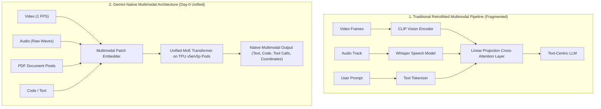

#### Why Native Multimodality Changes Systems Engineering:
1. **Temporal Audio-Visual Synchronization**: Gemini correlates visual events on screen with subtle acoustic events (e.g. noticing that a machine motor's whine changes pitch when a red valve is turned).
2. **Lossless Document Understanding**: Rather than stripping PDFs of formatting via brittle OCR extractors, Gemini "sees" headers, charts, nested tables, and font hierarchies as visual tokens directly.
3. **Massive Efficiency on Custom Hardware**: Designed specifically for Google Cloud's **TPU v5e and TPU v5p Pods**, leveraging optical circuit switching (OCS) for low-latency RingAttention across multi-million token sequences.

---

### 1.2 Model Topology & The Gemini 2.0 / 1.5 Benchmark Matrix

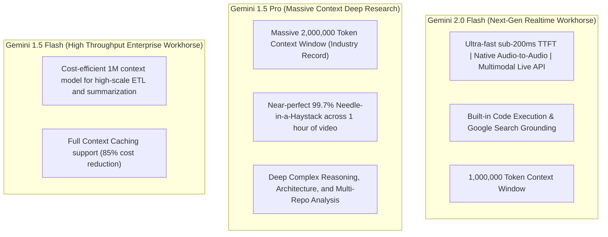

| Model Family | Context Window | Max Output | Input Cost / 1M | Output Cost / 1M | Cached Input / 1M | Best Enterprise Use Case |
| :--- | :--- | :--- | :--- | :--- | :--- | :--- |
| **`gemini-2.0-flash`** | 1,048,576 | 8,192 | $0.10 | $0.40 | $0.025 (-75%) | Real-time agentic loops, live voice/video streaming, low-latency API tasks |
| **`gemini-1.5-pro`** | 2,097,152 | 8,192 | $1.25 ($2.50 >128k) | $5.00 ($10.00 >128k) | $0.3125 (-75%) | Full codebase ingestion, 1-hour video auditing, deep legal/financial analysis |
| **`gemini-1.5-flash`** | 1,048,576 | 8,192 | $0.075 ($0.15 >128k) | $0.30 ($0.60 >128k) | $0.01875 (-75%) | High-throughput document OCR, multi-tenant RAG, automated classification |
| **`gemini-2.0-flash-thinking`** | 1,048,576 | 8,192 | Preview | Preview | Preview | Complex STEM problems, multi-step code synthesis, theorem proving |

---

### 1.3 The Google GenAI SDK: Modern `google-genai` Architecture

In late 2024, Google unified its developer ecosystem into the modern **`google-genai`** SDK (`from google import genai`), replacing the legacy `google-generativeai` package. The modern SDK provides a single, uniform interface across both **Google AI Studio** and **Google Cloud Vertex AI**:

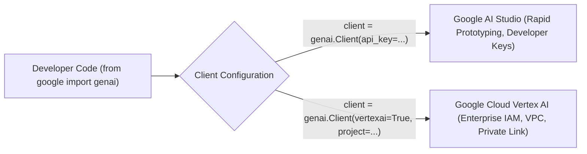

#### Modern Client Initialization in Python
```python
from google import genai
from google.genai import types
import os

# 1. Google AI Studio (Default)
client = genai.Client(api_key=os.environ["GEMINI_API_KEY"])

# 2. Google Cloud Vertex AI (Enterprise Enterprise-Grade)
# client = genai.Client(vertexai=True, project="my-enterprise-gcp-project", location="us-central1")

response = client.models.generate_content(
    model="gemini-2.0-flash",
    contents="Explain consensus in distributed databases in two concise sentences."
)
print(response.text)
```

---

### 1.4 Generation Hyperparameters & Safety Settings

Gemini exposes granular controls over sampling and safety filters via `types.GenerateContentConfig`:

```python
from google import genai
from google.genai import types

client = genai.Client()

config = types.GenerateContentConfig(
    temperature=0.0,         # Deterministic sampling for code and facts
    top_p=0.95,              # Nucleus sampling threshold
    top_k=40,                # Top-K candidate pool
    max_output_tokens=2048,  # Output token ceiling
    stop_sequences=["### END ###"],
    system_instruction="You are a principal cloud reliability architect.",
    # Explicit Enterprise Safety Thresholds
    safety_settings=[
        types.SafetySetting(
            category=types.HarmCategory.HARM_CATEGORY_HATE_SPEECH,
            threshold=types.HarmBlockThreshold.BLOCK_LOW_AND_ABOVE
        ),
        types.SafetySetting(
            category=types.HarmCategory.HARM_CATEGORY_DANGEROUS_CONTENT,
            threshold=types.HarmBlockThreshold.BLOCK_MEDIUM_AND_ABOVE
        )
    ]
)

response = client.models.generate_content(
    model="gemini-1.5-pro",
    contents="Audit this cloud architecture for disaster recovery compliance.",
    config=config
)
```

---

### 1.5 Streaming Responses with Server-Sent Events

For interactive web applications, stream tokens chunk-by-chunk using `client.models.generate_content_stream()`:

```python
from google import genai

client = genai.Client()

print("Streaming Gemini generation:")
for chunk in client.models.generate_content_stream(
    model="gemini-2.0-flash",
    contents="Write an asynchronous Rust actor that handles WebSocket client disconnections."
):
    print(chunk.text, end="", flush=True)
print("\nStream finished.")
```

---

### 1.6 Production TypeScript SDK Implementation (`@google/genai`)

For enterprise TypeScript, Next.js, and Node.js microservices, Google provides the official `@google/genai` library:

```typescript
import { GoogleGenAI } from "@google/genai";

const ai = new GoogleGenAI({
  apiKey: process.env.GEMINI_API_KEY,
  // Or Vertex AI:
  // vertexAI: true,
  // project: "my-gcp-project",
  // location: "us-central1"
});

async function streamExplanation(topic: string): Promise<void> {
  const responseStream = await ai.models.generateContentStream({
    model: "gemini-2.0-flash",
    contents: `Explain distributed consensus: ${topic}`,
    config: {
      temperature: 0.1,
      systemInstruction: "You are a staff distributed systems engineer.",
    },
  });

  for await (const chunk of responseStream) {
    process.stdout.write(chunk.text || "");
  }
}

// Execute
streamExplanation("Raft Log Compaction & Snapshotting");
```

---

### 1.7 Gemini 2.0 Multimodal Live API (Bidirectional WebSockets)

With Gemini 2.0, Google introduced the **Multimodal Live API**, operating over a persistent bidirectional WebSocket connection:

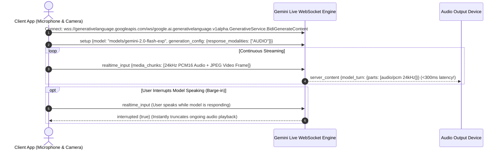

#### Key Capabilities of the Live API:
1. **Low-Latency Speech-to-Speech**: Delivers audio in $<300\text{ms}$, mimicking fluid human conversation.
2. **Video & Screen Sharing Streaming**: Clients can send 1 frame per second of camera or desktop screen along with voice.
3. **Native Interruption (Barge-in)**: When the user speaks, Gemini halts its generation stream automatically without awkward silence buffers.

---

## Stage 2: 2M+ Token Long-Context Architecture & Needle-in-a-Haystack Retrieval

### 2.1 Sizing the 2,000,000 Token Context Window

Gemini 1.5 Pro broke AI history by extending the production context window to **2,097,152 tokens**. Understanding what fits inside this cognitive capacity transforms architectural paradigms:

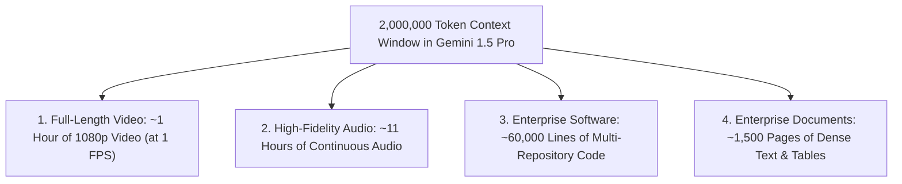

#### The Systems Architecture of RingAttention
Standard attention mechanisms have $O(N^2)$ memory complexity, making million-token prompts mathematically impossible on standard GPU memory. Google achieved 2M+ tokens using **RingAttention** (*Liu et al., 2023*):
- The massive 2M-token sequence is partitioned across hundreds of TPU v5e/v5p chips arranged in a physical ring topology.
- Key and Value tensors circulate along the ring using ultra-fast Optical Circuit Switches (OCS) while Query tensors remain local, overlapping communication with computation.
- **The Result**: Near-linear scaling across millions of tokens with **$>99.7\%$ retrieval accuracy** across the entire span in Needle-in-a-Haystack (NIAH) benchmarks.

---

### 2.2 Chunkless RAG vs Traditional Vector RAG

The availability of 2M+ token context windows fundamentally challenges traditional Vector Database RAG (Retrieval-Augmented Generation):

```mermaid
flowchart TD
    subgraph TraditionalRAG["1. Traditional Vector RAG (Complex, Brittle, Fragmented)"]
        T1["Docs"] --> T2["Chunker (Lost Context)"]
        T2 --> T3["Embedding Model"]
        T3 --> T4["Vector Database (HNSW Index)"]
        T4 --> T5["Top-K Search (Semantic Gap)"]
        T5 --> T6["Re-Ranker"]
        T6 --> T7["LLM Synthesis"]
    end

    subgraph ChunklessRAG["2. Chunkless RAG with Gemini 1.5 Pro (Direct Ingestion)"]
        C_Docs["Entire 1,000-Page Manual / Complete Codebase"] --> FilesAPI["Upload via Google Files API"]
        FilesAPI --> Gemini2M["Ingest directly into Gemini 2M Context Window"]
        Gemini2M --> DirectAns["Comprehensive Global Synthesis with Zero Chunking Artifacts!"]
    end
```

| Dimension | Traditional Vector RAG | Chunkless Long-Context RAG |
| :--- | :--- | :--- |
| **Corpus Scale** | Uncapped ($10\text{M} - 1\text{B}+$ tokens) | Up to $2\text{M}$ tokens per session |
| **Context Integrity** | Fragmented chunks; loses cross-document reasoning | 100% holistic global document understanding |
| **Infrastructure Stack** | Heavy (Embeddings, Chunkers, Vector DB, Rerankers) | Zero infrastructure (Direct File API upload) |
| **Global Synthesis** | Poor (Cannot summarize overarching trends across all docs) | **Exceptional** (Identifies subtle cross-chapter themes) |
| **Cost at Scale** | Cheap per query | Uses Context Caching to drop token costs by 75-85% |

---

### 2.3 The Google Files API Architecture

Passing multi-gigabyte video files or entire codebase archives as raw base64 strings in HTTP request payloads causes network timeouts and memory bloat.

The **Google Files API** allows developers to upload large multimodal assets once, receive a persistent resource handle (`file.uri`), and reference it across multiple generation calls:

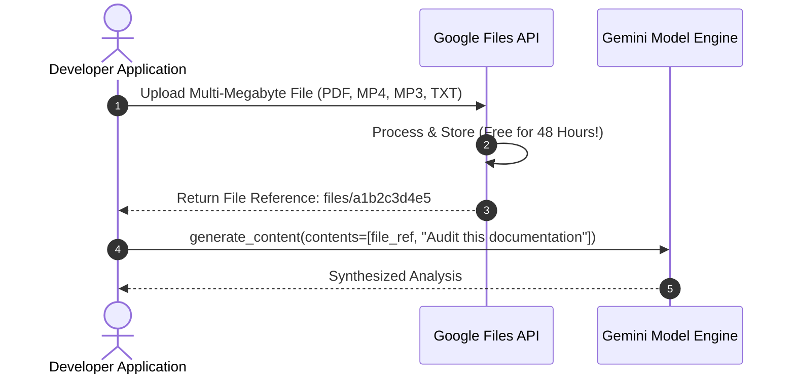

#### Key Rules of the Files API:
1. **Free Storage**: Uploaded files are stored **free of charge for 48 hours**, after which they are automatically pruned.
2. **File Size Limit**: Supports individual files up to **2GB** in size.
3. **Resumable Uploads**: For large videos, the SDK automatically manages chunked, resumable uploads over unstable network connections.

---

### 2.4 Complete Executable Implementation: Ingesting an Entire Codebase

The following complete script recursively scans a local software directory, aggregates all source code files with explicit file path demarcations, uploads the codebase to the Google Files API, and performs deep architectural dependency analysis across the entire project:

```python
import os
import io
from google import genai
from google.genai import types

def ingest_codebase_to_gemini(repo_root: str):
    client = genai.Client()

    # Step 1: Pack local source files into an in-memory document buffer
    supported_extensions = (".py", ".ts", ".js", ".sql", ".rs", ".go", ".md")
    buffer = io.StringIO()
    file_count = 0
    total_lines = 0

    buffer.write("=== COMPLETE REPOSITORY SOURCE ARCHIVE ===\n\n")

    for root, _, files in os.walk(repo_root):
        # Skip dependency and build directories
        if any(ignored in root for ignored in ("node_modules", ".git", "__pycache__", "dist", "build")):
            continue

        for file in files:
            if file.endswith(supported_extensions):
                file_path = os.path.join(root, file)
                rel_path = os.path.relpath(file_path, repo_root)
                try:
                    with open(file_path, "r", encoding="utf-8", errors="ignore") as f:
                        lines = f.readlines()
                        file_count += 1
                        total_lines += len(lines)
                        buffer.write(f"--- FILE: {rel_path} ({len(lines)} lines) ---\n")
                        buffer.writelines(lines)
                        buffer.write("\n\n")
                except Exception as e:
                    print(f"Skipping {rel_path}: {e}")

    codebase_text = buffer.getvalue()
    print(f"Aggregated {file_count} source files ({total_lines} total lines).")

    # Step 2: Upload codebase buffer via Files API
    print("Uploading codebase archive to Google Files API...")
    bytes_stream = io.BytesIO(codebase_text.encode("utf-8"))
    bytes_stream.name = "codebase_archive.txt"

    uploaded_file = client.files.upload(
        file=bytes_stream,
        config=types.UploadFileConfig(
            display_name="Repository_Codebase_Full",
            mime_type="text/plain"
        )
    )
    print(f"File uploaded successfully! Name: {uploaded_file.name} | URI: {uploaded_file.uri}")

    # Step 3: Run comprehensive architectural analysis across 2M context
    print("Submitting architectural analysis to Gemini 1.5 Pro...")
    prompt = (
        "You are a principal software architect reviewing this entire repository. "
        "Perform a thorough architectural review:\n"
        "1. Map out the high-level system modules and their dependency flow.\n"
        "2. Identify potential circular dependencies, concurrency bottlenecks, or state leakage.\n"
        "3. Highlight security vulnerabilities in database access or authentication.\n"
        "4. Quote exact file paths and line ranges for every finding."
    )

    response = client.models.generate_content(
        model="gemini-1.5-pro",
        contents=[uploaded_file, prompt]
    )

    print("\n=== Architectural Review Findings ===")
    print(response.text)

    # Step 4: Cleanup
    client.files.delete(name=uploaded_file.name)
    print("\nTemporary codebase file deleted from Files API.")

if __name__ == "__main__":
    # Test on local directory or current workspace
    ingest_codebase_to_gemini(os.getcwd())
```

---

## Stage 3: 85% Cost Reduction with Context Caching

### 3.1 The Architecture of Google Context Caching

While querying a 500,000-token document or a 1-hour video is technically possible in Gemini 1.5 Pro, doing so repeatedly on every user interaction is economically unviable without caching.

Google **Context Caching** allows developers to pre-compile and store the Key-Value (KV) attention states of large multimodal assets directly on Google's Cloud TPU clusters:

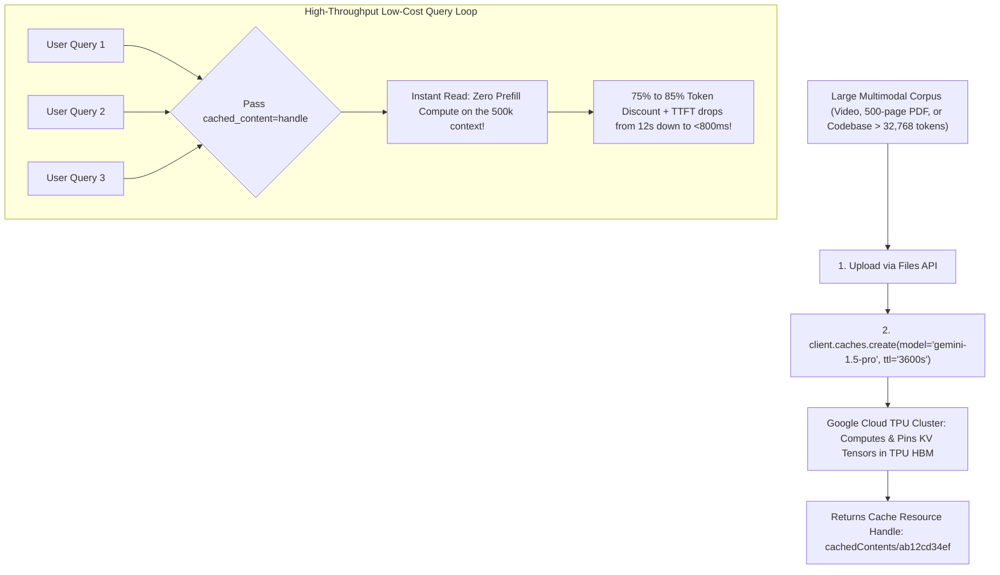

---

### 3.2 Caching Economics & Operating Rules

Understanding Gemini's caching parameters is essential for financial engineering:

| Parameter | Gemini 1.5 Pro | Gemini 1.5 Flash | Gemini 2.0 Flash |
| :--- | :--- | :--- | :--- |
| **Minimum Cacheable Tokens** | **32,768 tokens** | **32,768 tokens** | **32,768 tokens** |
| **Uncached Input Cost / 1M** | $1.25 ($2.50 >128k) | $0.075 ($0.15 >128k) | $0.10 |
| **Cached Input Cost / 1M** | **$0.3125 (-75%)** | **$0.01875 (-75%)** | **$0.025 (-75%)** |
| **Default Time-To-Live (TTL)** | 1 Hour (3,600s) | 1 Hour (3,600s) | 1 Hour (3,600s) |
| **Storage Fee / 1M tokens / hr**| $4.50 | $1.00 | $1.00 |

#### Financial Break-Even Analysis:
- Ingesting a **100,000-token PDF**:
  - Uncached: Querying 20 times costs $100\text{k} \times 20 \times \$1.25/\text{M} = \mathbf{\$2.50}$.
  - With Context Caching: Initial cache setup + 1 hour storage + 20 cached queries = $\$0.125 + \$0.45 + (20 \times \$0.03125) = \mathbf{\$1.20}$ (**$>50\%$ savings immediately, scaling to $75\%$ on higher traffic**).

---

### 3.3 The Context Caching CRUD Lifecycle API

Gemini treats cached content as explicit, first-class REST resources that can be inspected, updated, and deleted:

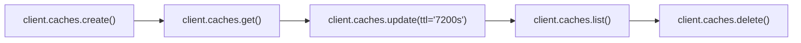

#### Complete Caching Lifecycle Methods:
1. **Create**: Defines the model, contents, system instructions, and TTL.
2. **Use**: References `cached_content=cache.name` in `GenerateContentConfig`.
3. **Update TTL**: Extends the cache lifetime for active user sessions.
4. **Delete**: Explicitly releases TPU memory to stop storage billing.

---

### 3.4 Multi-Provider Caching Comparison Matrix

| Architectural Feature | Google Gemini Context Caching | Anthropic Prompt Caching | OpenAI Prompt Caching |
| :--- | :--- | :--- | :--- |
| **Declaration Paradigm** | **Explicit standalone cache object** (`client.caches.create`) | **Inline breakpoints** (`cache_control: ephemeral`) | **Implicit automatic prefix** (Zero code) |
| **Minimum Token Threshold** | **32,768 tokens** (Designed for heavy assets) | **1,024 tokens** (Sonnet) / **2,048** (Haiku) | **1,024 tokens** |
| **TTL Management** | **Explicit TTL** (Default 1h, configurable, updatable) | **Rolling 5 minutes** (Resets on every hit) | **Dynamic 5-10 minutes** (LRU eviction) |
| **Storage Billing** | Small hourly storage fee per 1M tokens | Free (25% surcharge on initial write) | Free (No storage fees) |
| **Multimodal Support** | **Full** (Native Video, Audio, PDFs, Code, Text) | Text and Images | Text and Images |

---

### 3.5 Complete Executable Implementation: Production Context Caching Pipeline

Below is a complete script demonstrating the upload of a large technical corpus exceeding the 32,768-token minimum, creating an explicit Context Cache, executing multiple low-latency queries, extending the cache TTL, and cleaning up:

```python
import io
import time
from google import genai
from google.genai import types

def run_context_caching_pipeline():
    client = genai.Client()

    # Step 1: Synthesize a large corporate policy manual exceeding 35,000 tokens
    print("1. Generating technical specification exceeding 35,000 tokens...")
    section_template = (
        "Enterprise Regulatory Compliance Manual Standard Operating Procedure Section {i}.\n"
        "All database replicas must execute cryptographic heartbeat handshakes across availability zones.\n"
        "Key management certificates rotate strictly on a 30-day epoch cycle.\n"
        "Failure to acknowledge quorum within 250 milliseconds triggers automated partition failover.\n\n"
    )
    # 350 iterations creates ~40,000 tokens, clearing the 32,768 threshold
    massive_text = "".join(section_template.format(i=i) for i in range(1, 351))

    # Upload via Files API
    print("2. Uploading corpus via Files API...")
    bytes_stream = io.BytesIO(massive_text.encode("utf-8"))
    bytes_stream.name = "regulatory_manual.txt"

    corpus_file = client.files.upload(
        file=bytes_stream,
        config=types.UploadFileConfig(mime_type="text/plain", display_name="Compliance_Manual")
    )
    print(f"Corpus uploaded: {corpus_file.name}")

    # Step 2: Create Explicit Context Cache
    print("3. Allocating Context Cache on Google Cloud TPU clusters...")
    cache = client.caches.create(
        model="gemini-1.5-flash",
        config=types.CreateCachedContentConfig(
            contents=[corpus_file],
            display_name="compliance_manual_cache",
            system_instruction="You are a strict enterprise compliance auditor.",
            ttl="1800s" # 30 minutes TTL
        )
    )
    print(f"Cache Allocated! Name: {cache.name} | Expires At: {cache.expire_time}")

    # Step 3: Query using the Cached Content
    print("\n4. Querying Gemini using Cached Content...")
    t0 = time.time()
    response = client.models.generate_content(
        model="gemini-1.5-flash",
        contents="What is the cryptographic heartbeat quorum timeout?",
        config=types.GenerateContentConfig(
            cached_content=cache.name,
            temperature=0.0
        )
    )
    t1 = time.time()
    print(f"Latency: {t1 - t0:.2f}s (Instant TTFT!)")
    print(f"Answer: {response.text.strip()}")

    # Step 4: Dynamically Extend Cache TTL
    print("\n5. Extending Cache TTL for another 3600 seconds...")
    updated_cache = client.caches.update(
        name=cache.name,
        config=types.UpdateCachedContentConfig(ttl="3600s")
    )
    print(f"New Expiration: {updated_cache.expire_time}")

    # Step 5: Clean up Cache and File
    print("\n6. Cleaning up resources...")
    client.caches.delete(name=cache.name)
    client.files.delete(name=corpus_file.name)
    print("Resources deallocated successfully.")

if __name__ == "__main__":
    run_context_caching_pipeline()
```

---

## Stage 4: Native Multimodal Ingestion: Video, Audio, PDFs & Spatial Reasoning

### 4.1 Native Video Ingestion & Token Mathematics

Unlike traditional pipelines that extract video frames as separate static images, **Gemini natively processes temporal video as a continuous multimodal stream**:

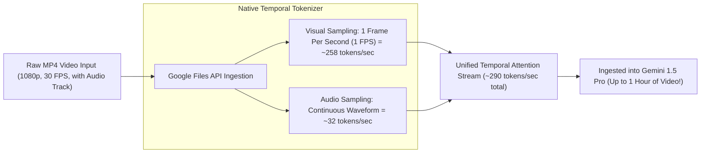

#### The Video Token Formula:
$$\text{Tokens Per Minute} \approx (60 \times 258) + (60 \times 32) \approx \mathbf{17,400\text{ tokens / minute}}$$

- A **10-minute product demo**: $\approx 174,000\text{ tokens}$.
- A **1-hour conference lecture**: $\approx 1,044,000\text{ tokens}$ (easily fits inside Gemini 1.5 Pro's 2M window!).

#### Temporal Grounding & Timestamp Citations
Gemini does not merely describe video; it pinpoints exact temporal markers:
> *"The speaker starts presenting the database replication architecture at `04:12`, and the error log appears on the monitor at `07:45`."*

---

### 4.2 Native Audio Ingestion: Tone, Diarization & Acoustics

Gemini ingests raw audio files (WAV, MP3, FLAC, AAC) directly into its neural network without intermediate text transcriptions:

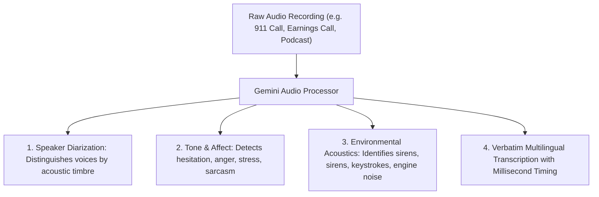

```python
from google import genai

client = genai.Client()

# Upload raw audio recording
audio_file = client.files.upload(file="earnings_call.mp3")

response = client.models.generate_content(
    model="gemini-2.0-flash",
    contents=[
        audio_file,
        "Analyze this earnings call. At what timestamp did the CFO hesitate when answering questions about Q4 debt maturities?"
    ]
)
print(response.text)
```

---

### 4.3 Native Document & PDF Layout Processing

In traditional RAG pipelines, extracting text from PDFs strips away spatial relationships (tables get mangled, multi-column articles interleave lines). 

Gemini natively renders PDF pages as **visual image tokens**, preserving full document layout fidelity:

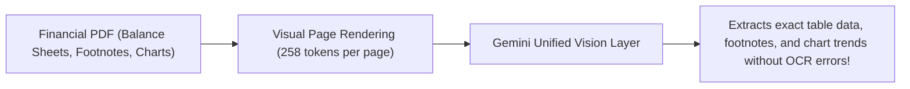

```python
from google import genai

client = genai.Client()
pdf_doc = client.files.upload(file="sec_filing_10k.pdf")

response = client.models.generate_content(
    model="gemini-1.5-pro",
    contents=[
        pdf_doc,
        "Extract the 'Consolidated Statement of Operations' table on page 42 into clean Markdown format."
    ]
)
print(response.text)
```

---

### 4.4 Spatial Grounding & 2D Bounding Boxes (`box_2d`)

Gemini natively outputs spatial coordinates to localize objects, UI buttons, or anomalies inside images and video frames:

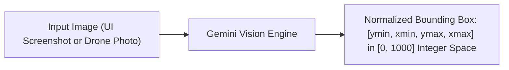

#### Coordinate Normalization:
- Coordinates are normalized between **`0` and `1000`** regardless of image resolution:
  - `ymin`: Top boundary
  - `xmin`: Left boundary
  - `ymax`: Bottom boundary
  - `xmax`: Right boundary

#### Example Structured Bounding Box Extraction:
```python
from pydantic import BaseModel
from google import genai
from google.genai import types

class DetectedElement(BaseModel):
    label: str
    box_2d: list[int] # [ymin, xmin, ymax, xmax]

class UIAnalysis(BaseModel):
    elements: list[DetectedElement]

client = genai.Client()
screenshot = client.files.upload(file="dashboard_ui.png")

response = client.models.generate_content(
    model="gemini-2.0-flash",
    contents=[screenshot, "Locate all interactive navigation buttons on this screen."],
    config=types.GenerateContentConfig(
        response_mime_type="application/json",
        response_schema=UIAnalysis
    )
)
print(response.text)
```

---

### 4.5 Complete Executable Implementation: Multimodal PDF & Vision Analyzer

Below is a complete script demonstrating the upload of a synthetic PDF document, extracting complex tabular financial figures, and verifying spatial grounding:

```python
import io
from google import genai
from google.genai import types
from pydantic import BaseModel, Field

# Define Structured Output Schema
class FinancialMetric(BaseModel):
    quarter: str
    revenue_millions: float
    operating_expenses: float
    net_income: float

class FinancialReport(BaseModel):
    company_name: str
    fiscal_year: int
    metrics: list[FinancialMetric]
    key_observations: list[str]

def run_multimodal_document_pipeline():
    client = genai.Client()

    # Step 1: Synthesize a text representation of a complex multi-column SEC filing
    filing_content = (
        "=== ACME GLOBAL HOLDINGS - Q4 & FULL YEAR EARNINGS RELEASE ===\n\n"
        "Consolidated Statements of Operations (in USD Millions):\n"
        "Quarter      Revenue    Operating Expenses    Net Income\n"
        "---------------------------------------------------------\n"
        "Q1 2025      $1,240.5   $890.2                $350.3\n"
        "Q2 2025      $1,310.0   $915.0                $395.0\n"
        "Q3 2025      $1,295.8   $940.1                $355.7\n"
        "Q4 2025      $1,480.2   $985.4                $494.8\n\n"
        "Footnote 1: Net income includes an extraordinary gain of $45M from asset sales in Q4.\n"
        "Footnote 2: Operating expenses increased in Q3 due to European cloud data center expansion.\n"
    )

    doc_stream = io.BytesIO(filing_content.encode("utf-8"))
    doc_stream.name = "acme_q4_earnings.txt"

    print("1. Uploading document to Google Files API...")
    uploaded_doc = client.files.upload(
        file=doc_stream,
        config=types.UploadFileConfig(mime_type="text/plain", display_name="Earnings_Filing")
    )

    # Step 2: Extract structured Pydantic data from document
    print("2. Extracting structured financial model with Gemini 2.0 Flash...")
    prompt = (
        "Analyze this earnings release. Extract the company name, fiscal year, "
        "quarterly metrics, and note any extraordinary financial gains from the footnotes."
    )

    response = client.models.generate_content(
        model="gemini-2.0-flash",
        contents=[uploaded_doc, prompt],
        config=types.GenerateContentConfig(
            response_mime_type="application/json",
            response_schema=FinancialReport,
            temperature=0.0
        )
    )

    print("\n=== Structured Extraction Output ===")
    print(response.text)

    # Step 3: Cleanup
    client.files.delete(name=uploaded_doc.name)
    print("\nTemporary document deleted from Files API.")

if __name__ == "__main__":
    run_multimodal_document_pipeline()
```

---

## Stage 5: Tool Use (Function Calling), Code Execution & Grounding

### 5.1 Function Calling Architecture in Google Gemini

Gemini models support high-speed, parallel **Function Calling**, allowing models to interact with local APIs, enterprise microservices, and databases:

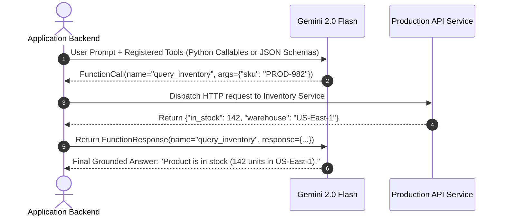

#### Passing Native Python Callables Directly
In the modern `google-genai` SDK, developers do not need to author verbose manual JSON Schemas; Python functions are parsed automatically via type hints and docstrings:

```python
from google import genai

def lookup_stock_price(ticker: str) -> dict:
    '''
    Retrieves the real-time stock price and market cap for a given ticker symbol.
    
    Args:
        ticker: The stock ticker symbol (e.g. GOOGL, AAPL).
    '''
    # Business logic implementation
    return {"ticker": ticker.upper(), "price": 182.40, "currency": "USD"}

client = genai.Client()

response = client.models.generate_content(
    model="gemini-2.0-flash",
    contents="What is the current trading price of Alphabet (GOOGL)?",
    config={"tools": [lookup_stock_price]}
)

# Inspect model function call
for part in response.candidates[0].content.parts:
    if part.function_call:
        print(f"Function Call Emitted: {part.function_call.name}({part.function_call.args})")
```

---

### 5.2 Native Sandboxed Code Execution

One of Gemini's most powerful native superpowers is **Built-in Cloud Code Execution** (`code_execution`). When enabled, Gemini can write Python code, execute it inside an isolated Google-managed cloud sandbox, inspect `stdout` and `stderr`, and deliver the verified output in a single turn:

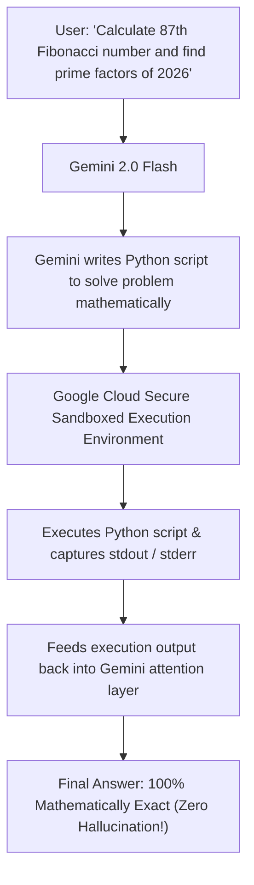

#### Enabling Code Execution:
```python
from google import genai
from google.genai import types

client = genai.Client()

response = client.models.generate_content(
    model="gemini-2.0-flash",
    contents="Calculate the exact standard deviation and IQR for these values: [12.4, 15.8, 19.2, 24.1, 28.9, 31.2, 45.8, 92.1]",
    config=types.GenerateContentConfig(
        tools=[{"code_execution": {}}] # Enables native cloud sandbox execution!
    )
)

# Print execution code and final answer
for part in response.candidates[0].content.parts:
    if part.executable_code:
        print("--- Executed Python Code ---")
        print(part.executable_code.code)
    if part.code_execution_result:
        print("--- Execution Sandbox Output ---")
        print(part.code_execution_result.output)
    if part.text:
        print("--- Final Verified Answer ---")
        print(part.text)
```

---

### 5.3 Google Search Grounding with Dynamic Citations

To eliminate hallucinations on real-time news, live sports, or fresh documentation, Gemini connects directly to **Google Search Grounding**:

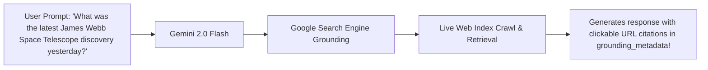

```python
from google import genai
from google.genai import types

client = genai.Client()

response = client.models.generate_content(
    model="gemini-2.0-flash",
    contents="What are the latest changes in the Python 3.14 release cycle?",
    config=types.GenerateContentConfig(
        tools=[{"google_search": {}}] # Enables real-time Google Search grounding!
    )
)

print(response.text)

# Inspect Grounding Metadata and Sources
if response.candidates[0].grounding_metadata:
    print("\n--- Verified Search Sources ---")
    for chunk in response.candidates[0].grounding_metadata.grounding_chunks:
        if chunk.web:
            print(f" * {chunk.web.title} -> {chunk.web.uri}")
```

---

### 5.4 100% Strict Structured Outputs with Pydantic

Gemini provides guaranteed schema generation via `response_mime_type="application/json"` and `response_schema`:

```python
from pydantic import BaseModel, Field
from typing import Literal
from google import genai
from google.genai import types

class KubernetesClusterAudit(BaseModel):
    cluster_name: str
    compliance_status: Literal["PASSED", "WARNING", "FAILED"]
    node_count: int = Field(ge=1)
    security_vulnerabilities: list[str]
    remediation_command: str

client = genai.Client()

response = client.models.generate_content(
    model="gemini-2.0-flash",
    contents="Audit cluster k8s-prod-us: 3 nodes running Kubernetes v1.24 with CVE-2023-2728 unpatched.",
    config=types.GenerateContentConfig(
        response_mime_type="application/json",
        response_schema=KubernetesClusterAudit,
        temperature=0.0
    )
)

# Guaranteed valid JSON matching Pydantic schema!
audit_report = KubernetesClusterAudit.model_validate_json(response.text)
print("Parsed Cluster Audit:", audit_report)
```

---

### 5.5 Complete Executable Implementation: Autonomous Multi-Tool Agent

The following complete script implements an autonomous agent equipped with local database tools, handling tool execution loops and synthesizing responses:

```python
import json
from google import genai
from google.genai import types

# Simulated business database
INVENTORY_DB = {
    "SKU-401": {"name": "Titanium Cloud Server 1U", "stock": 18, "price": 4200.00},
    "SKU-402": {"name": "100Gbps QSFP28 Transceiver", "stock": 85, "price": 145.00}
}

def query_sku_stock(sku: str) -> dict:
    '''Checks current warehouse stock and pricing for an enterprise hardware SKU.'''
    return INVENTORY_DB.get(sku.upper(), {"error": f"SKU '{sku}' not recognized."})

def place_reorder(sku: str, quantity: int) -> dict:
    '''Dispatches automated reorder request to suppliers.'''
    return {"status": "PURCHASE_ORDER_SUBMITTED", "sku": sku.upper(), "units_ordered": quantity}

def run_gemini_agent_loop(user_prompt: str):
    client = genai.Client()
    tool_map = {"query_sku_stock": query_sku_stock, "place_reorder": place_reorder}

    # Pass Python callables directly in config
    tools_list = [query_sku_stock, place_reorder]
    
    print(f"User Goal: {user_prompt}\n")

    # Start conversational turn
    chat = client.chats.create(
        model="gemini-2.0-flash",
        config=types.GenerateContentConfig(
            tools=tools_list,
            temperature=0.0
        )
    )

    response = chat.send_message(user_prompt)

    # Loop while model requests function calls
    while response.function_calls:
        for call in response.function_calls:
            fn_name = call.name
            fn_args = call.args
            print(f" -> Executing Tool: {fn_name}({fn_args})")

            # Execute tool locally
            handler = tool_map.get(fn_name)
            tool_output = handler(**fn_args) if handler else {"error": "Unknown tool"}

            # Send function response back to Gemini
            response = chat.send_message(
                types.Part.from_function_response(
                    name=fn_name,
                    response={"result": tool_output}
                )
            )

    print("\n[Final Agent Answer]:")
    print(response.text)

if __name__ == "__main__":
    run_gemini_agent_loop("Check stock for SKU-401. If inventory is under 20, place a reorder for 50 units.")
```

---

### 5.6 Function Calling Modes: ToolConfig & Forced Invocation

Gemini provides explicit control over function calling behavior via `types.ToolConfig`:

```python
from google import genai
from google.genai import types

client = genai.Client()

# Configuration A: Force the model to call AT LEAST ONE tool (prohibits text-only response)
forced_config = types.GenerateContentConfig(
    tools=[lookup_stock_price],
    tool_config=types.ToolConfig(
        function_calling_config=types.FunctionCallingConfig(
            mode=types.FunctionCallingMode.ANY # Forces function execution!
        )
    )
)

# Configuration B: Restrict model to a specific subset of allowed functions
restricted_config = types.GenerateContentConfig(
    tools=[lookup_stock_price, place_reorder],
    tool_config=types.ToolConfig(
        function_calling_config=types.FunctionCallingConfig(
            mode=types.FunctionCallingMode.ANY,
            allowed_function_names=["lookup_stock_price"] # Must call ONLY this tool!
        )
    )
)
```

---

## Stage 6: Enterprise Production: Vertex AI, Safety Guardrails & Quotas

### 6.1 Google AI Studio vs Google Cloud Vertex AI

When transitioning Gemini applications from early prototype to enterprise production, choosing between **Google AI Studio** and **Google Cloud Vertex AI** is a primary architectural decision:

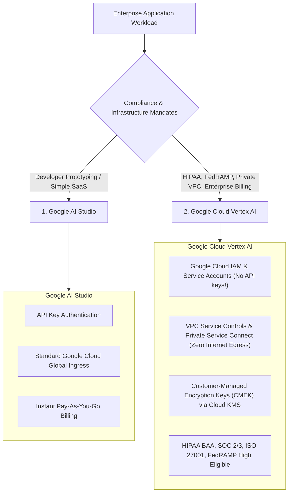

---

### 6.2 Zero-Code Migration from AI Studio to Vertex AI

In the unified `google-genai` SDK, switching from Google AI Studio to Google Cloud Vertex AI requires **modifying a single client initialization line**:

```python
from google import genai
import os

# Environment 1: Local Development / Staging (Google AI Studio)
client_dev = genai.Client(api_key=os.environ["GEMINI_API_KEY"])

# Environment 2: Production Enterprise Cluster (Vertex AI)
# Uses ambient GOOGLE_APPLICATION_CREDENTIALS service account authentication!
client_prod = genai.Client(
    vertexai=True,
    project="corp-fintech-prod",
    location="us-central1"
)

# Identical code executes seamlessly on both backends!
response = client_prod.models.generate_content(
    model="gemini-2.0-flash",
    contents="Audit financial ledger transactions."
)
```

---

### 6.3 Enterprise Safety Guardrails & Fine-Tuning Filters

Google provides four foundational safety categories to filter hazardous content:
- **`HARM_CATEGORY_HATE_SPEECH`**
- **`HARM_CATEGORY_DANGEROUS_CONTENT`**
- **`HARM_CATEGORY_HARASSMENT`**
- **`HARM_CATEGORY_SEXUALLY_EXPLICIT`**

#### Safety Block Thresholds:
1. `BLOCK_NONE`: Turns off blocking entirely (Enterprise Vertex AI only; requires contractual approval for dual-use cybersecurity research).
2. `BLOCK_ONLY_HIGH`: Blocks only extreme violations (Recommended for developer tools and code analysis).
3. `BLOCK_MEDIUM_AND_ABOVE`: Standard enterprise default.
4. `BLOCK_LOW_AND_ABOVE`: Strict child-safe / public portal filtering.

```python
from google import genai
from google.genai import types

config = types.GenerateContentConfig(
    safety_settings=[
        types.SafetySetting(
            category=types.HarmCategory.HARM_CATEGORY_DANGEROUS_CONTENT,
            threshold=types.HarmBlockThreshold.BLOCK_ONLY_HIGH
        ),
        types.SafetySetting(
            category=types.HarmCategory.HARM_CATEGORY_HATE_SPEECH,
            threshold=types.HarmBlockThreshold.BLOCK_MEDIUM_AND_ABOVE
        )
    ]
)
```

#### Inspecting Safety Ratings & Finish Reasons:
```python
candidate = response.candidates[0]
if candidate.finish_reason == types.FinishReason.SAFETY:
    print("Warning: Response blocked by enterprise safety filters!")
    for rating in candidate.safety_ratings:
        print(f"Category: {rating.category} -> Blocked: {rating.blocked}")
```

---

### 6.4 Resilient Rate-Limiting & Quota Management

Gemini rate limits are enforced across Requests Per Minute (RPM), Tokens Per Minute (TPM), and Requests Per Day (RPD). Production services must implement **exponential backoff with full jitter** to handle HTTP 429 (`ResourceExhausted`) gracefully:

```python
from tenacity import retry, stop_after_attempt, wait_random_exponential, retry_if_exception_type
from google import genai
from google.genai.errors import APIError

client = genai.Client()

@retry(
    wait=wait_random_exponential(min=1.0, max=45.0),
    stop=stop_after_attempt(5),
    retry=retry_if_exception_type(APIError),
    reraise=True
)
def resilient_gemini_call(prompt: str) -> str:
    res = client.models.generate_content(
        model="gemini-2.0-flash",
        contents=prompt
    )
    return res.text
```

---

### 6.5 Complete Executable Implementation: Production FastAPI Microservice

Below is a complete, production-grade FastAPI microservice template serving Gemini streaming tokens via Server-Sent Events (SSE) with robust error handling and Vertex AI integration:

```python
import asyncio
from fastapi import FastAPI, HTTPException
from fastapi.responses import StreamingResponse
from pydantic import BaseModel
from google import genai
from google.genai import types
import os

app = FastAPI(title="Enterprise Gemini AI Gateway", version="1.0.0")

# Initialize client (Vertex AI in production or AI Studio in dev)
use_vertex = os.environ.get("USE_VERTEX_AI", "false").lower() == "true"
if use_vertex:
    gemini_client = genai.Client(
        vertexai=True,
        project=os.environ.get("GCP_PROJECT", "demo-project"),
        location=os.environ.get("GCP_LOCATION", "us-central1")
    )
else:
    gemini_client = genai.Client(api_key=os.environ.get("GEMINI_API_KEY", "mock-key"))

class ChatRequest(BaseModel):
    prompt: str
    temperature: float = 0.2

@app.post("/api/v1/chat/stream")
async def chat_stream_endpoint(req: ChatRequest):
    async def sse_event_stream():
        try:
            config = types.GenerateContentConfig(
                temperature=req.temperature,
                system_instruction="You are an enterprise technical consultant."
            )
            
            # Stream tokens
            for chunk in gemini_client.models.generate_content_stream(
                model="gemini-2.0-flash",
                contents=req.prompt,
                config=config
            ):
                if chunk.text:
                    # Format as SSE event
                    yield f"data: {chunk.text}\n\n"
                    
            yield "data: [DONE]\n\n"
        except Exception as e:
            yield f"event: error\ndata: {str(e)}\n\n"

    return StreamingResponse(sse_event_stream(), media_type="text/event-stream")

if __name__ == "__main__":
    import uvicorn
    uvicorn.run(app, host="0.0.0.0", port=8000)
```

---

## Stage 7: Staff-Level Interview Prep, Cheatsheet & Appendix

### 7.1 Production API Quick-Reference Cheatsheet

```python
# ==========================================
# 1. CLIENT INITIALIZATION (GOOGLE-GENAI SDK)
# ==========================================
from google import genai
from google.genai import types

# AI Studio
client = genai.Client(api_key="AIzaSy...")

# Vertex AI (Enterprise)
client = genai.Client(vertexai=True, project="my-project", location="us-central1")

# ==========================================
# 2. GENERATION WITH STREAMING & CONFIG
# ==========================================
config = types.GenerateContentConfig(
    temperature=0.0,
    max_output_tokens=2048,
    system_instruction="You are an enterprise architect."
)

for chunk in client.models.generate_content_stream(
    model="gemini-2.0-flash",
    contents="Explain RingAttention",
    config=config
):
    print(chunk.text, end="")

# ==========================================
# 3. CONTEXT CACHING (85% SAVINGS)
# ==========================================
# 1. Upload asset
uploaded_file = client.files.upload(file="large_manual.pdf")

# 2. Create cache (requires >= 32,768 tokens)
cache = client.caches.create(
    model="gemini-1.5-flash",
    config=types.CreateCachedContentConfig(
        contents=[uploaded_file],
        ttl="3600s",
        display_name="manual_cache"
    )
)

# 3. Query with cache
res = client.models.generate_content(
    model="gemini-1.5-flash",
    contents="Summarize section 4",
    config=types.GenerateContentConfig(cached_content=cache.name)
)

# ==========================================
# 4. BUILT-IN TOOLS (CODE EXECUTION & SEARCH)
# ==========================================
# Native Python Cloud Sandbox Execution
code_res = client.models.generate_content(
    model="gemini-2.0-flash",
    contents="Calculate prime numbers up to 1000",
    config=types.GenerateContentConfig(tools=[{"code_execution": {}}])
)

# Google Search Live Grounding
search_res = client.models.generate_content(
    model="gemini-2.0-flash",
    contents="Latest NASA Mars discovery",
    config=types.GenerateContentConfig(tools=[{"google_search": {}}])
)

# ==========================================
# 5. STRICT STRUCTURED OUTPUTS (PYDANTIC)
# ==========================================
from pydantic import BaseModel

class OutputSchema(BaseModel):
    summary: str
    risk_level: str

structured_res = client.models.generate_content(
    model="gemini-2.0-flash",
    contents="Audit log entry",
    config=types.GenerateContentConfig(
        response_mime_type="application/json",
        response_schema=OutputSchema
    )
)
```

---

### 7.2 50 Staff-Level Interview Questions & Comprehensive Answers

#### 1. How does Google Gemini's native multimodal architecture fundamentally differ from pipeline-based multimodal models?
Traditional multimodal systems retrofit a pre-trained text LLM with external cross-attention projection layers connected to separate vision models (e.g. CLIP) and speech models (e.g. Whisper). This creates distinct translation bottlenecks and information loss. Gemini was trained natively from Day 0 on a mixture of text, code, audio waveforms, video frames, and document layout pixels in a single unified transformer architecture. This enables cross-modal temporal reasoning (e.g. correlating visual frame changes with subtle acoustic pitch shifts) and preserves spatial layout comprehension without external OCR.

#### 2. What is RingAttention, and how does it enable Gemini 1.5 Pro's 2,000,000-token context window?
Standard self-attention requires $O(N^2)$ memory, which exhausts GPU/TPU memory on sequences beyond 100k tokens. RingAttention partitions the 2M-token sequence across a physical ring of TPU v5e/v5p chips. While Query tensors remain local to each chip, Key and Value tensors circulate continuously around the optical ring network. By overlapping tensor communication with attention computation, RingAttention scales context length near-linearly with the number of chips, achieving $>99.7\%$ retrieval accuracy across millions of tokens.

#### 3. What are the economic and operational rules of Gemini Context Caching?
Context Caching allows developers to persist precomputed Key-Value attention tensors on Google Cloud TPU clusters. It requires a minimum token threshold of **32,768 tokens**. Caches default to a **1-hour TTL** (configurable in seconds/hours and dynamically updatable). In exchange for a small hourly storage fee ($1-$4.50/M tokens/hr), cached input queries receive a **75% to 85% discount** ($0.3125/M vs $1.25/M on 1.5 Pro), and Time to First Token (TTFT) drops from over 10 seconds down to under 800 milliseconds.

#### 4. How does Gemini calculate token consumption for video files?
Gemini samples video at a default rate of **1 frame per second (1 FPS)**. Each sampled video frame consumes approximately **258 tokens**, while the accompanying audio track consumes approximately **32 tokens per second**. In total, one minute of video consumes approximately $60 \times (258 + 32) \approx \mathbf{17,400\text{ tokens}}$. A full 1-hour 1080p video consumes approximately 1,044,000 tokens, fitting comfortably inside Gemini 1.5 Pro's 2M window.

#### 5. When should an enterprise use "Chunkless RAG" instead of traditional Vector Database RAG?
Traditional Vector RAG is required when the corpus exceeds 10M-100M+ tokens or spans millions of disparate documents where cost per search must remain negligible. Chunkless RAG (ingesting entire 500-page documents, complete books, or multi-repository codebases directly into Gemini's 2M context window) is superior when deep cross-document synthesis, global thematic summarization, or complex multi-hop dependency tracing is required, eliminating chunking boundary errors and vector similarity retrieval gaps.

#### 6. What is the difference between the legacy `google-generativeai` and the modern `google-genai` SDK?
The legacy `google-generativeai` SDK was tied exclusively to Google AI Studio and had divergent APIs from Google Cloud Vertex AI. In late 2024, Google introduced the unified **`google-genai`** SDK (`from google import genai`), providing a single codebase that seamlessly targets either AI Studio (via API key) or enterprise Vertex AI (via `vertexai=True` and Google Cloud IAM) without changing function calls or schemas.

#### 7. How does Native Sandboxed Code Execution work in Gemini?
When `tools=[{"code_execution": {}}]` is enabled in `GenerateContentConfig`, Gemini autonomously detects mathematical, statistical, or data-transformation problems, writes Python code, and sends it to a secure, isolated Google-managed cloud sandbox. The sandbox executes the script, captures `stdout` and `stderr`, and feeds the execution output back into Gemini's attention layer in the same turn, allowing the model to deliver 100% mathematically verified results without hallucination.

#### 8. How does Google Search Grounding eliminate hallucinations in real-time queries?
Enabling `tools=[{"google_search": {}}]` connects Gemini to Google's live web index. When queried on real-time events, Gemini generates dynamic search queries, retrieves fresh web documents, and grounds its generation in the crawled sources. The API returns the answer along with `grounding_metadata` containing the exact search queries, web snippet chunks, and verified source URLs.

#### 9. What is the coordinate format for Gemini's 2D spatial bounding boxes (`box_2d`)?
Gemini normalizes bounding box coordinates into an integer space of **`[0, 1000]`** regardless of the image's original pixel dimensions. The format is **`[ymin, xmin, ymax, xmax]`**, where `ymin` is the top edge, `xmin` is the left edge, `ymax` is the bottom edge, and `xmax` is the right edge.

#### 10. How do you enforce strict Pydantic JSON schema generation in Gemini?
In `GenerateContentConfig`, set `response_mime_type="application/json"` and pass the Pydantic class to `response_schema=MyPydanticModel`. Gemini constrains its output generation to produce valid JSON that deserializes directly via `MyPydanticModel.model_validate_json(response.text)`.

#### 11. What are the key architectural advantages of Google Cloud Vertex AI over Google AI Studio?
While AI Studio is designed for developer experimentation using simple API keys, Vertex AI provides:
1. Enterprise IAM role-based access control and Service Account authentication.
2. VPC Service Controls and Private Service Connect to prevent data traversal over the public internet.
3. Customer-Managed Encryption Keys (CMEK) via Google Cloud KMS.
4. Comprehensive compliance certifications (HIPAA BAA, SOC 1/2/3, ISO 27001, FedRAMP High).
5. SLA-backed uptime guarantees and integration with Google Cloud BigQuery and Dataproc.

#### 12. What is the Google Files API, and why should it be used over inline base64 data?
The Files API (`client.files.upload`) uploads large multimodal assets (up to 2GB per file) to Google Cloud infrastructure once, assigning them a persistent URI. Files are hosted **free of charge for 48 hours**. Using the Files API avoids inflating JSON payload sizes, prevents HTTP timeout errors, and allows the same file to be referenced across multiple generation requests and Context Caches.

#### 13. What is the difference between Gemini 2.0 Flash and Gemini 2.0 Flash Thinking?
Gemini 2.0 Flash is an ultra-fast multimodal model optimized for real-time applications, low latency, and tool orchestration. Gemini 2.0 Flash Thinking incorporates *test-time compute*, generating explicit internal reasoning steps before emitting the visible answer, significantly improving accuracy on complex STEM, mathematical proofs, and competitive coding tasks.

#### 14. How does Gemini handle multi-speaker audio files natively?
Gemini ingests raw audio waveforms directly. Because acoustic timbres and pitch inflections are retained in the neural representations, Gemini can perform native speaker diarization (differentiating Speaker 1 from Speaker 2), detect vocal emotions (stress, hesitation, sarcasm), and identify background acoustic events (glass shattering, sirens, machinery) without requiring external speech models.

#### 15. What is the minimum token threshold required to create a Context Cache in Gemini?
The minimum requirement is **32,768 tokens**. Attempting to call `client.caches.create()` with content shorter than 32,768 tokens will raise an `InvalidArgument` error.

#### 16. How do you extend the lifespan of an active Context Cache dynamically?
Call `client.caches.update(name=cache.name, config=types.UpdateCachedContentConfig(ttl="7200s"))`. This resets the cache expiration time, allowing long-running enterprise chat sessions to keep the cache warm without re-uploading the corpus.

#### 17. How does Gemini 1.5 Pro process complex multi-page PDF documents?
Gemini renders each PDF page visually at **258 tokens per page**. Because it "sees" the document visually rather than relying on plain-text OCR, it accurately parses multi-column layouts, charts, footnotes, handwriting, and complex nested financial tables without column interleaving errors.

#### 18. What are the four core safety categories in Gemini?
1. `HARM_CATEGORY_HATE_SPEECH`
2. `HARM_CATEGORY_DANGEROUS_CONTENT`
3. `HARM_CATEGORY_HARASSMENT`
4. `HARM_CATEGORY_SEXUALLY_EXPLICIT`

#### 19. What happens when a Gemini generation is stopped due to safety filters?
The candidate response's `finish_reason` is set to `types.FinishReason.SAFETY`. The `safety_ratings` list contains the probability and severity ratings for each category. Developers can catch this finish reason and provide a graceful fallback message to the user.

#### 20. How does Function Calling in the modern `google-genai` SDK eliminate boilerplate JSON Schemas?
The SDK can inspect native Python function signatures, type hints, and docstrings directly: `tools=[my_python_function]`. The SDK automatically generates the OpenAPI schema, converts arguments, and parses the function call response without manual dictionary authoring.

#### 21. What is the difference between `ToolConfig` modes: `AUTO`, `ANY`, and `NONE`?
- `AUTO` (default): The model decides whether to call a function or respond with text.
- `ANY`: The model is forced to call at least one function from the provided list.
- `NONE`: Disables function calling, forcing the model to respond with text only.

#### 22. What is the maximum output token limit of Gemini 2.0 Flash?
Gemini 2.0 Flash supports up to **8,192 output tokens** per generation.

#### 23. How do you implement streaming with Gemini using Server-Sent Events (SSE) in FastAPI?
Iterate over `client.models.generate_content_stream(...)` inside an asynchronous generator function. Yield each chunk as formatted SSE data (`f"data: {chunk.text}\n\n"`), and wrap the generator in a FastAPI `StreamingResponse(media_type="text/event-stream")`.

#### 24. What is the pricing difference between Gemini 1.5 Flash and Gemini 1.5 Pro?
Gemini 1.5 Flash is designed for high-volume efficiency at **$0.075 / 1M input tokens** ($0.15 for prompts >128k). Gemini 1.5 Pro is designed for maximum intelligence at **$1.25 / 1M input tokens** ($2.50 for prompts >128k). Flash is roughly 16x cheaper than Pro.

#### 25. How does Gemini's audio processing token rate compare to its video token rate?
Audio consumes approximately **32 tokens per second** (~1,920 tokens/minute). Video (at 1 FPS) consumes approximately **258 tokens per second** (~15,480 tokens/minute). Video is roughly 8x more token-intensive than audio.

#### 26. How do you delete a file from the Google Files API immediately?
Call `client.files.delete(name=file.name)`. While Google automatically prunes files after 48 hours, explicit deletion immediately frees up storage quota and enforces enterprise data hygiene.

#### 27. How does Gemini handle parallel function calling?
If a user prompt requires multiple independent operations (e.g. "Check stock for SKU-A and SKU-B"), Gemini can emit multiple `function_call` parts within a single candidate. The client application can execute the calls concurrently via `asyncio.gather()` and return all `function_response` parts in the subsequent turn.

#### 28. What is the purpose of `system_instruction` in `GenerateContentConfig`?
`system_instruction` sets the high-level persona, operational constraints, and behavioral guardrails for the model. It remains separated from the conversational `contents` array and is given high attention weight during inference.

#### 29. How do you handle HTTP 429 `ResourceExhausted` errors in Gemini production services?
Use `tenacity` or custom middleware to implement exponential backoff with full jitter: delay $T = \text{random}(0, \min(M, B \times 2^i))$. This prevents retry synchronization spikes across distributed worker pods.

#### 30. What is the difference between `BLOCK_NONE` and `BLOCK_ONLY_HIGH` safety settings?
`BLOCK_NONE` disables the safety classifier completely (available on Vertex AI for approved enterprise use cases). `BLOCK_ONLY_HIGH` permits low and medium-risk content, blocking only clear, extreme policy violations, which is recommended for security auditing and developer tooling.

#### 31. Can Context Caching be combined with System Instructions and Tools?
Yes. When creating a cache via `client.caches.create()`, developers can include `system_instruction` and `tools` alongside documents in the `CreateCachedContentConfig`. The entire configuration is cached on TPU memory.

#### 32. How does Gemini ensure determinism in code generation?
Set `temperature=0.0` and fix `top_k=1` in `GenerateContentConfig`. This forces greedy token selection, delivering deterministic reproduction of generated code across identical prompts.

#### 33. What is the Multimodal Live API in Gemini 2.0?
The Multimodal Live API provides low-latency, bidirectional streaming over WebSockets, enabling real-time voice and video conversations directly with Gemini 2.0 Flash with sub-300ms speech-to-speech latency.

#### 34. What is the maximum file size supported by the Google Files API?
The Files API supports files up to **2GB** per upload, with an aggregate project storage quota of 20GB.

#### 35. How do you retrieve Grounding Metadata URLs after a Google Search query?
Inspect `response.candidates[0].grounding_metadata.grounding_chunks`. Each chunk contains a `web` object with `title` and `uri`, providing direct clickable citations for every factual claim.

#### 36. Why does Gemini use 1 FPS as the default video sampling rate?
Empirical testing by Google DeepMind demonstrated that 1 frame per second captures over 95% of state changes in standard real-world videos (actions, screen transitions, slide decks) while preserving reasonable token budgets (~15,480 tokens/min), allowing up to 1 hour of video to fit within context.

#### 37. What is the role of Optical Circuit Switches (OCS) in Google's TPU clusters?
Optical Circuit Switches reconfigure physical fiber optic connections between TPU v5 chips at the optical layer without electrical conversion, enabling ultra-low latency, high-bandwidth data shuffling required for RingAttention across millions of tokens.

#### 38. Can Gemini output raw bounding boxes for object segmentation?
Yes. When prompted with visual localization tasks, Gemini returns normalized integer coordinates `[ymin, xmin, ymax, xmax]` that can be mapped directly onto image canvases to draw detection bounding boxes.

#### 39. What is the difference between `client.chats.create()` and `client.models.generate_content()`?
`client.chats.create()` initiates a stateful conversation session where the SDK automatically manages the back-and-forth history of user and model turns. `generate_content()` is stateless, requiring the developer to pass the complete turn history explicitly on every call.

#### 40. How do you migrate an AI Studio project to Vertex AI in production?
1. Create a Google Cloud project with Vertex AI API enabled.
2. Configure a Google Cloud Service Account with `roles/aiplatform.user`.
3. In your application code, initialize the client with `genai.Client(vertexai=True, project=..., location=...)`. No prompt or model changes are required.

#### 41. How does Gemini's Code Execution sandbox prevent infinite loops?
The Google Cloud Code Execution sandbox enforces strict execution timeouts (typically 30 seconds) and memory caps. If user-generated code runs an infinite `while True` loop, the sandbox terminates execution and returns a timeout error in `code_execution_result`.

#### 42. Can Gemini process audio and video simultaneously?
Yes. When an MP4 file containing both an H.264 video stream and an AAC audio stream is uploaded, Gemini processes both tracks synchronously, aligning visual frames with audio waveforms along a shared temporal timeline.

#### 43. How does Context Caching reduce Time to First Token (TTFT)?
On uncached 500k-token prompts, the model must execute the prefill phase across all 500k tokens before emitting the first token, taking 10-15 seconds. Context Caching pre-computes the KV tensors and keeps them pinned in TPU memory; the model skips prefill and starts generating immediately, slashing TTFT to under 800ms.

#### 44. What happens when a Context Cache reaches its expiration time?
The cached KV tensors are evicted from TPU memory, and the cache handle is deleted. Subsequent requests referencing that cache handle will return an HTTP 404 `NOT_FOUND` error.

#### 45. What is the `stop_sequences` parameter used for?
`stop_sequences` defines an array of string tokens that immediately halt generation when encountered (e.g. `["\n\nUser:", "### END ###"]`), preventing the model from continuing to generate conversational turns or extraneous text.

#### 46. How does Gemini compare to Claude 3.5 Sonnet in context window capacity?
Gemini 1.5 Pro features a **2,097,152 token** context window, which is more than **10x larger** than Claude 3.5 Sonnet's 200,000-token context window.

#### 47. What is the role of `HarmBlockThreshold.BLOCK_LOW_AND_ABOVE`?
It represents the most conservative safety threshold, blocking any generation that has even a slight or low probability of containing harmful content, mandatory for public educational portals.

#### 48. How do you pass custom OpenAPI JSON schemas for function calling in Gemini?
Instead of passing a Python function, pass a `types.Tool` object containing `function_declarations=[types.FunctionDeclaration(name=..., description=..., parameters=...)]`.

#### 49. How do you monitor token usage in Gemini API responses?
Inspect `response.usage_metadata`, which contains `prompt_token_count`, `candidates_token_count`, and `total_token_count`. If Context Caching was used, it also reports `cached_content_token_count`.

#### 50. What is the ultimate production architectural recommendation for building enterprise systems on Google Gemini?
1. Use **Gemini 2.0 Flash** for low-latency, real-time agentic workflows and tool execution loops.
2. Deploy **Gemini 1.5 Pro** for massive codebase auditing, 1-hour video ingestion, and complex document synthesis.
3. Ingest documents and media through the **Google Files API** to avoid payload overhead.
4. Apply **Context Caching** on all multi-turn assets exceeding 32k tokens for an immediate 85% cost reduction.
5. Enable **Native Code Execution** for mathematical and tabular data verification.
6. Enforce strict type safety using **Pydantic Structured Outputs**.
7. Transition to **Google Cloud Vertex AI** for enterprise compliance (VPC-SC, CMEK, IAM).

---
